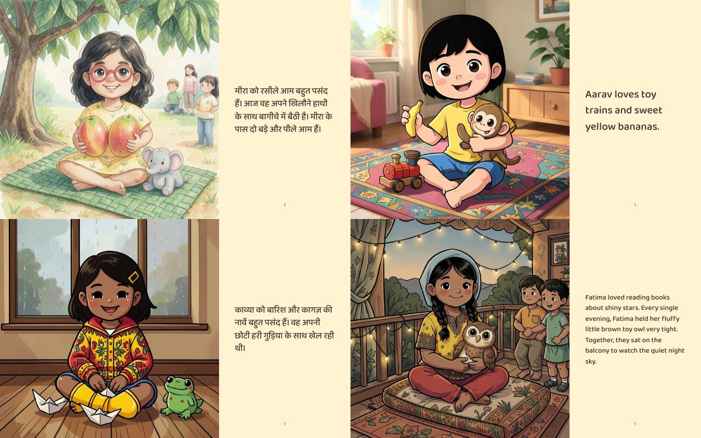

# Kahaani

A parent fills in a short form and, in about a minute, gets an illustrated, narrated
storybook in **Hindi or English** with their child as the hero, as a **PDF** and a
**read-along video**. Everything runs on free tiers and open models: **₹0**.

<!-- RESULTS:START -->


| | |
|---|---|
| Time per book | ~70 s (story 7 s, 5 pictures 35 s, checks 15 s, PDF + video 10 s) |
| Character consistency (vision judge, 1–5) | **5.0** with the reference picture vs **3.2** baseline |
| Quality review (30 stories) | 28 shown (7 with grammar fixed automatically), 2 sent back for a rewrite |
| Safety suite | **50/50** unsafe inputs blocked, **0/11** false alarms |
| Story quality (LLM judge, 1–5) | 4.4–5.0 on all five criteria |
| Cost | **₹0** (about 20 books/day on the free tiers) |
<!-- RESULTS:END -->

## How it works

```
      Next.js site (form → hero approval → reader → redo a page → downloads)
                                        │  polls a job over HTTP
                         FastAPI (kahaani/api.py), one book at a time
                                        │
                     BookMaker.start(brief) / .finish(draft) / .redo_page(...)
                                        │
 ┌──────────────┬───────────────┬───────┴────────┬────────────────┬──────────────┐
 ▼              ▼               ▼                ▼                ▼              ▼
1 Input       2 Story         3 Hero           4 Pages          5 Narration    6 Assembly
  safety        planner         picture          FLUX.2 klein     edge-tts       HTML → PDF
  rules →       Gemini JSON     (parent          drawn FROM the   (runs while    (WeasyPrint)
  LLM check     + validator     approves or      approved hero    pages draw)    PDF → PNG →
                + 1 repair      re-rolls)        picture                         MP4 (moviepy)
                retry                                │
                                                     ▼
                                        Output safety: story text (LLM),
                                        all pictures in one vision call
                                                     ▼
                                        Quality review: an AI editor (grammar,
                                        sense, double meanings, age fit) plus
                                        code checks for broken images and
                                        injection leftovers. Fix, redo or refuse.

 Shared: swappable providers · fallback chains · disk cache · retry/backoff honouring
 Retry-After · cooldown for failing providers · logs without personal data
```

Key design choices:

- **The hero picture is the reference for every page.** Cloudflare's FLUX.2 [klein] accepts
  reference images, so the live app gets reference conditioning (like IP-Adapter) for free.
  The page prompt puts the scene first and says "same child as the reference, new pose", or
  the model just copies the reference pose.
- **Pictures never contain text.** The words are typeset on the page, so nothing garbled.
- **Story text is in Hindi or English; image prompts are always English.** The child's name is
  removed from image prompts before they leave the app.
- **User text is data, never instructions.** It goes into prompts as escaped JSON inside
  `<brief>` tags, after rule checks for injection patterns (including Hindi, Hinglish and
  s-p-a-c-e-d-o-u-t tricks).
- **Validator + one repair retry.** Page count, sentences and words per sentence for the
  child's age, the name on page 1 and most pages, pure Devanagari for Hindi, English image
  notes, and no stated moral for ages 7–8. Problems are fed back to the model once.
- **WeasyPrint, not ReportLab.** WeasyPrint shapes text with HarfBuzz, so conjuncts like
  क्ष, त्र and श्र render correctly. ReportLab breaks them.
- **Free-tier engineering.** Gemini's free tier allows ~20 requests/day per model, so the app
  chains several Gemini models, then Groq. It honours `Retry-After`, gives up at once on daily
  quotas, and skips a failing provider for a cooldown instead of re-waiting on every call.

## Stack (all free)

| Part | Tool |
|---|---|
| Story | Gemini (`gemini-3.8-flash` → `3.5-flash` → `3.5-flash-lite`), then Groq `gpt-oss-120b` |
| Safety and vision checks | Gemini flash-lite (most free quota) |
| Pictures | Cloudflare Workers AI, FLUX.2 [klein] 4B with reference image |
| Consistency experiment | SDXL + IP-Adapter on a free Kaggle T4 (`notebooks/`) |
| Voice | edge-tts (`hi-IN-SwaraNeural`, `en-IN-NeerjaNeural`, rate −10%) |
| PDF | WeasyPrint + Baloo 2 / Noto Sans Devanagari |
| Video | pdf2image + moviepy (each page lasts as long as its narration) |
| Website | Next.js 16 (static export) + Tailwind CSS v4; Fraunces and Hind fonts |
| API and hosting | FastAPI, one Docker container (Render free tier) |
| CI | GitHub Actions: ruff, pytest, safety suite |

## Run it yourself

```bash
uv sync
cp .env.example .env              # add GEMINI_API_KEY, GROQ_API_KEY, CLOUDFLARE_ACCOUNT_ID/_API_TOKEN
cd web && npm install && npm run build && cd ..
uv run python -m kahaani.api      # site + API on http://127.0.0.1:8000
```

While working on the website, run the API (`uv run python -m kahaani.api`) and
`npm run dev` in `web/` side by side; the dev site on :3000 talks to the API on :8000.

- **macOS:** `brew install pango poppler`.
- **Linux:** `apt install libpango-1.0-0 libpangoft2-1.0-0 poppler-utils`.

Without Cloudflare keys the app draws simple placeholder shapes, so you can still work on
everything else. Without Supabase, accounts and books live in `.data/` (SQLite and a folder);
set `KAHAANI_DEV_AUTH=1` to sign in with any name instead of Google.

Command line:

```bash
uv run python -m kahaani.pipeline.planner --lang hi --age 5          # story JSON only
uv run python -m kahaani.pipeline.create_book --lang hi --style folk --out out/  # PDF + MP4
uv run python -m kahaani.samples b01 b02                              # rebuild sample books
uv run pytest                                                         # no API calls
```

### Accounts and storage (Supabase, free)

1. Create a project at supabase.com. From **Project settings → API**, copy the project URL, the
   `anon` key and the `service_role` key into `SUPABASE_URL`, `SUPABASE_ANON_KEY` and
   `SUPABASE_SERVICE_KEY`. From **Database → Connect**, copy the connection string into
   `DATABASE_URL` (use the `postgresql+psycopg://` prefix).
2. Google sign-in: in Google Cloud Console create an **OAuth client ID** (web application) with
   the redirect URI `https://<project>.supabase.co/auth/v1/callback`. Paste its client ID and
   secret into Supabase under **Authentication → Providers → Google**.
3. In Supabase **Authentication → URL configuration**, add your site's address (for example
   `http://127.0.0.1:8000` and your Render URL) to the allowed redirect URLs.
4. Set `KAHAANI_URL_SECRET` to any long random string.

On start-up the API creates its tables in a private `kahaani` schema (row-level security on,
not exposed through Supabase's public REST API) and a private storage bucket.

### Deploy

The `Dockerfile` builds the website, installs pango, poppler and ffmpeg, and runs everything
in one container on `$PORT`. It works on any Docker host. On **Render** (free, no card):

1. New **Web Service** → connect this GitHub repo → runtime **Docker**, instance type **Free**.
2. Add the environment variables: `GEMINI_API_KEY`, `GROQ_API_KEY`, `CLOUDFLARE_ACCOUNT_ID`,
   `CLOUDFLARE_API_TOKEN`, the Supabase values above, and `KAHAANI_URL_SECRET`.
3. Deploy. The free tier sleeps after 15 idle minutes, so the first visit after a pause takes
   about a minute.

The container sets `KAHAANI_CACHE=0`, so a public server never writes a story to disk.
(Hugging Face Docker Spaces would also work, but since 2026 they need a PRO plan.)

## Project layout

```
web/                        Next.js website (see web/README.md)
Dockerfile                  one container: builds web/, runs the API on :7860
kahaani/
  api.py                    FastAPI: accounts, book jobs, library, signed file links, site
  library.py                saving books; the shared story library (matching, reuse)
  taste.py                  each child's taste, learned from feedback and reading
  db.py blobs.py auth.py    Postgres/SQLite tables, private file storage, Google sign-in
  config.py schemas.py cache.py samples.py
  providers/                llm_* (Gemini, Groq, fallback chain), image_* (Cloudflare,
                            placeholder, diffusers), tts.py, retry.py
  pipeline/                 safety, planner, reviewer, illustrator, narrator, assembler,
                            create_book
  prompts/                  prompt templates (.txt)
  templates/                book.html + fonts
eval/                       briefs, adversarial set, story eval, judge, consistency, report
notebooks/                  SDXL + IP-Adapter on Kaggle
samples/                    pre-made books shown in the app
tests/                      pytest, all providers faked
```

## Evaluation

See [eval/README.md](eval/README.md) for every script.

<!-- EVAL:START -->
### Character consistency (headline experiment)

Same stories and the same hero picture; only the way pages are drawn changes.


| Setup | How pages are drawn | CLIP page↔hero | Vision judge (1–5) | Judged "same child" (≥4) |
|---|---|---|---|---|
| Baseline | free-form description, new seed each page | 0.750 | 3.21 | 17% |
| Fixed prompt | identical character sentence + one seed per book | 0.787 | 4.78 | 93% |
| **Reference (the app)** | FLUX.2 [klein] drawn from the approved hero picture | **0.788** | **5.00** | **100%** |
| IP-Adapter (SDXL) | Kaggle T4 notebook, scale 0.6 | run `notebooks/ip_adapter_kaggle.ipynb` | | |

10 stories × 4 pages for the fixed and reference setups, 6 for the baseline (Cloudflare's
free allowance is about 100 images a day); `eval.consistency generate` resumes where it
stopped. CLIP barely separates fixed from reference; the judge does. The vision judge (Gemini) scores
hair, skin, outfit, glasses and accessories against the hero.

**Caveats:**
- CLIP also reacts to backgrounds and palette, which is why its gaps are smaller than the
  judge's.
- The reference setup partly scores perfectly because it sometimes reuses the hero's pose.
  That's a real weakness: the prompt now asks for a new pose, which helps but doesn't fully
  fix it.
- A blind human check (`make-human-pairs`: 20 pairs in a self-contained web page) is ready to
  send to raters.

### Story generation (30 briefs: 15 Hindi, 15 English, ages 3–8)

| Run | Valid | First try | Median time | Changes before the run |
|---|---|---|---|---|
| 1 | 21/30 | 14 | 17 s | (9 lost to free-tier rate limits) |
| 2 | 30/30 | 22 | 8 s | honour Retry-After, chain Gemini models, word limits in the prompt |
| 3 | 30/30 | 26 | 3 s | sentence counts in the prompt, skip failing providers, script and moral checks |

LLM judge, 30 stories (1–5): age-appropriate language **4.73**, lesson clear but not preachy
**4.37**, child is the hero **4.63**, no scary content **4.97**, coherent **4.73**.
`eval.story_judge --agreement` compares this against hand scores
(`eval/out/hand_scores.csv`, 20 stories), to check that the judge can be trusted.

### Safety (61 cases: 50 unsafe, 11 tricky-but-safe)

| Layer | Blocks |
|---|---|
| Form limits (schema) | 6 |
| Rules (blocklists in English, Hindi and Hinglish; injection patterns incl. s-p-a-c-e-d text; contact info; real people and brand characters) | 32 |
| LLM check (only what got past the rules) | 12 |
| **Total** | **50/50 blocked, 0/11 false alarms** |

The rules alone (free, instant, run in CI) catch 38/50. The LLM catches the subtle ones:
"medicine is candy", "climb the balcony railing", stereotypes, school names. Tuning the LLM
prompt fixed two false alarms: a surname read as personal data, and "loves fire trucks" read
as playing with fire.
### Quality review (30 stories, real model)

A second AI acts as the book's editor before anything is shown
(`uv run python -m eval.quality_review`):

| Decision | Stories |
|---|---|
| Shown as written | 21 |
| Shown after automatic grammar fixes | 7 |
| Sent back for a rewrite | 2 (a page that didn't follow, a story that resolved too early) |

Most fixes are Hindi details a native reader would notice: gender agreement
(अपनी चश्मे → अपने चश्मे), ये/यह, and English words swapped for Hindi ones (पॉकेट → जेब).
A fix is only used if the page still passes every rule (length, script, name); otherwise the
story is rewritten.
<!-- EVAL:END -->

## Limitations

- **Consistency is good but not perfect.** Secondary characters (a friend, a parent) are often
  dropped or redrawn differently, and poses can repeat the reference.
- **Free tiers are small.** Gemini allows ~20 requests/day per model, and Cloudflare's daily
  allowance covers about 100 FLUX.2 images (about 20 books). When they run out the app says so and points to the sample books.
- **Hindi spelling isn't checked.** The validator catches wrong scripts, not misspellings; the
  lite model occasionally makes small spelling slips.
- **One voice per language.**
- **The image check is an AI too.** It can miss things, so the parent always previews the book
  before downloading.

## Accounts, library and sharing

Parents sign in with Google and agree, once, to how books are stored. Every book goes into
their library, grouped by child, with reading progress synced across devices ("Page 2 of 4",
"Read 3 times"). They can change any page, report a book, delete a book, or delete their
account and everything in it.

**Shared story library.** Each newly written story is also kept as an anonymous template (the
name replaced by a placeholder, no narration). A later request from any family reuses it when
the idea matches, which saves time and free quota:

- the story, when language, reading level (age band), lesson, length and girl/boy match and
  favourite things overlap enough;
- the drawings too, when the art style matches and the described character is nearly the
  same. All drawings are fictional, made only from typed words.

Edge cases this handles:

| Case | What happens |
|---|---|
| Hindi verbs change with the hero's gender | girl/boy is part of the match, and the story prompt |
| Latin name in a Hindi story (Aarav → आरव) | spelt once by the model, checked for Devanagari, cached |
| Custom lessons | never shared (too personal, and fuzzy matches would be wrong) |
| Same family, same details | opens the existing book; "Write a new version" skips that template |
| A shared story turns out flawed | one "Report a problem" pulls it out of sharing |
| Prompts or checks change | templates are versioned, so old ones retire |
| Editing a page of a shared book | that page becomes the family's own copy; others are untouched |
| Reused story fails today's rules after the name swap | it isn't used; a new story is written |
| Many families on one mobile network (shared IP) | limits count per account, not per IP |
| One person with many Google accounts | a global daily cap protects the shared free quotas |
| Free storage (1 GB) | about 1 MB per book (PDF and video rebuilt on request); 30 books per account |
| Siblings | books are grouped per child; a birth year is stored, so ages stay right |
| Deleting an account | its books and files go; shared templates (no names) stay but lose the link |
| Pictures in `` tags can't send the sign-in token | signed links that expire after an hour |
| Server restarts while a book is being made | only finished books are saved; nothing half-made |
| Overloaded model (HTTP 504) | moves to the next model at once instead of waiting minutes |

## Learning each child's taste

After reading, parents can rate a book (**Loved it / It was okay / Not for us**) and tick
quick tags: funny, calm for bedtime, more adventure, too long or short, too easy or hard,
preachy lesson, and loved or disliked pictures. Reading behaviour counts too: re-reading a
book is a strong "loved it", finishing it a mild one, abandoning it halfway a mild "not for us".

`kahaani/taste.py` turns this into a small profile per child:

- **Recent feedback counts more** (half-life two months). Length and word difficulty only use
  feedback from the child's current age band, because "too hard" at 4 may be right at 6.
- **The next story follows it** through fixed instructions: "funny" adds gentle jokes and a
  repeatable sound; "shorter pages" sets an exact sentence count at the low end of the age
  range. In a test, the same brief went from 3 sentences per page to 2, with jokes added.
- **The form shows it**: picking a child fills in their details and favourite art style and
  shows "What we've learned about Meera", with **Use this** and **Forget this**.
- **Siblings are separate**, since each child has their own profile.
- **No injection risk**: feedback is buttons and tags, never free text, and the prompt only
  ever gets fixed wording.
- **Shared library**: taste-tuned stories only reuse templates written with the same taste.
  A template that at least three different families mark "Not for us" (and more dislike than
  like) leaves sharing; one account can't do that alone. Well-liked templates are tried first.

## Privacy and safety

- No photos. The child is described in words only, and every picture is a fictional drawing.
- Books are stored only after the parent signs in and agrees, and only they can open them
  (checked on every request; files go through expiring signed links). Shared templates never
  contain a name. Logs hold timings and error types only, never names or story text.
- Layered checks on the way in: form limits and a fixed lesson list; Unicode clean-up (look-alike
  letters, zero-width characters); rule checks in English, Hindi and Hinglish; then an AI that
  classifies the request's intent (describes a child, instructions to the AI, off topic,
  harmful) and flags injection attempts separately.
- Layered checks on the way out: an LLM safety check and a quality review of the story
  (grammar, sense, double meanings, abuse, age fit) before any picture is drawn; rule checks
  for injection leftovers in generated text; code checks for broken, blank or flat images; and
  one vision check over all pictures for safety, stray writing, distorted bodies and scene
  match (redrawn once if flagged, otherwise replaced by the hero picture with a note to the
  parent).
- The parent sees every check in "How this book was checked" under the book.
- Each visitor can make 3 books a day, and the app makes one book at a time.

## What I'd build next

Word-by-word read-along highlighting (edge-tts already returns word timings), a proofreading
pass for Hindi, more Indian languages, and print-ready PDFs with bleed.
