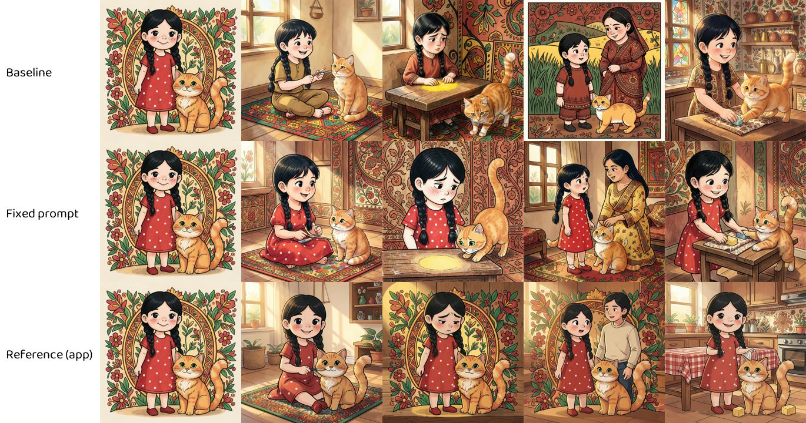

# Kahaani

Kahaani makes personalised picture books for children aged 3 to 8. A parent describes their
child in a few words and receives an illustrated, narrated story in Hindi or English, with
their child as the hero, as a PDF book and a read-along video.


## Features

- **Stories at the child's reading level.** Sentence length and vocabulary follow the child's
  age, and each story teaches a lesson the parent picks (sharing, bravery, honesty, kindness,
  trying new food, sleeping on time, or their own).
- **Hindi and English.** Story text, narration and the printed book support both languages,
  with correct Devanagari shaping.
- **A consistent hero.** The parent approves a picture of the hero first; every page is then
  drawn from that picture, so the child looks the same throughout. Three art styles:
  watercolour, cartoon and Indian folk art.
- **PDF and read-along video.** Each video page lasts as long as its narration.
- **Page-level editing.** Any single page can be rewritten and redrawn from a short request.
- **A personal library.** Books are saved per child, with reading progress synced across
  devices.
- **Learns each child's taste.** Ratings and quick tags ("funny", "calm for bedtime",
  "too long", "too hard") shape the next story for that child.
- **Faster books through sharing.** Anonymous copies of finished stories (no names) are
  reused when another family asks for a matching idea.
- **Layered safety and quality checks** on every request, story and picture, shown to the
  parent under each book.

## How it works

```
Website (Next.js)  →  API (FastAPI)  →  book pipeline

 1. Check the request     rule checks, then an AI check of intent and prompt injection
 2. Reuse or write        a matching shared story, or a new one generated as JSON and
                          checked by a validator (one repair attempt if needed)
 3. Review the story      safety check, then an AI editor for grammar, sense, double
                          meanings and age fit; small fixes are applied automatically
 4. Draw the hero         the parent approves it or asks for another
 5. Draw every page       using the hero picture as a reference image
 6. Check the pictures    broken-image checks, then a vision check for safety, stray
                          writing, distorted bodies and scene match
 7. Narrate               text-to-speech, in parallel with drawing
 8. Assemble and save     HTML → PDF → page images → MP4, saved to the family's library
```

Key design decisions:

- **Reference-conditioned illustration.** Pages are drawn with FLUX.2 [klein], which accepts
  the approved hero picture as a reference image. Prompts put the scene first and ask for a
  new pose, so the model keeps the character without copying the reference composition.
- **No text inside pictures.** Story text is typeset on the page instead.
- **User input is treated as data.** Free text reaches prompts only as escaped JSON inside
  delimiters, after rule checks for injection patterns in English, Hindi and Hinglish
  (including spaced-out letters, look-alike characters and zero-width characters).
- **Deterministic validation.** Page count, sentences and words per sentence for the age
  group, the hero's name, script purity for Hindi, and English-only image prompts are checked
  in code.
- **Provider fallback.** Several Gemini models are tried in order, then Groq. Rate limits and
  overloaded models trigger an immediate switch, and a failing provider is rested before it is
  tried again.
- **WeasyPrint for PDFs.** It shapes text with HarfBuzz, which renders Hindi conjuncts such as
  क्ष, त्र and श्र correctly.

## Tech stack

| Area | Technology |
|---|---|
| Story generation | Google Gemini, with Groq (`gpt-oss-120b`) as fallback |
| Safety and vision checks | Gemini |
| Illustrations | Cloudflare Workers AI, FLUX.2 [klein] 4B |
| Narration | edge-tts (`hi-IN-SwaraNeural`, `en-IN-NeerjaNeural`) |
| PDF | WeasyPrint, with Baloo 2 and Noto Sans Devanagari |
| Video | pdf2image and moviepy |
| Website | Next.js 16 (static export), TypeScript, Tailwind CSS v4 |
| API | FastAPI (Python 3.12) |
| Accounts and storage | Supabase: Google sign-in, Postgres, private file storage |
| Deployment | A single Docker image serving the website and the API |
| CI | GitHub Actions: ruff, pytest, safety suite, website lint and build |

## Getting started

### Requirements

- Python 3.12 and [uv](https://docs.astral.sh/uv/)
- Node.js 22
- pango and poppler
  - macOS: `brew install pango poppler`
  - Debian/Ubuntu: `apt install libpango-1.0-0 libpangoft2-1.0-0 poppler-utils`

### Install and run

```bash
uv sync
cp .env.example .env          # then fill in your keys
cd web && npm install && npm run build && cd ..
uv run python -m kahaani.api  # http://127.0.0.1:8000
```

For local development without Google sign-in, set `KAHAANI_DEV_AUTH=1`. Without Supabase
settings, accounts and books are stored locally in `.data/`. Without Cloudflare keys, pictures
are replaced by simple placeholder shapes.

To work on the website with hot reload, run the API as above and `npm run dev` in `web/`.
The development site on port 3000 uses the API on port 8000.

### Configuration

All settings are environment variables; see [.env.example](.env.example).

| Variable | Purpose |
|---|---|
| `GEMINI_API_KEY`, `GEMINI_MODEL` | Story generation (comma-separated models, tried in order) |
| `GROQ_API_KEY`, `GROQ_MODEL` | Fallback story generation |
| `VISION_MODEL` | Models for safety and picture checks |
| `CLOUDFLARE_ACCOUNT_ID`, `CLOUDFLARE_API_TOKEN` | Illustrations |
| `CLOUDFLARE_IMAGE_MODEL`, `IMAGE_PROVIDER` | Image model; `placeholder` for offline development |
| `SUPABASE_URL`, `SUPABASE_ANON_KEY`, `SUPABASE_SERVICE_KEY`, `SUPABASE_JWT_SECRET` | Sign-in and file storage |
| `DATABASE_URL` | Postgres connection (`postgresql+psycopg://…`); SQLite if unset |
| `KAHAANI_URL_SECRET` | Signs the short-lived links to pictures and downloads |
| `BOOKS_PER_DAY`, `GLOBAL_BOOKS_PER_DAY` | Per-account and site-wide daily limits |
| `REQUIRE_IMAGE_CHECK` | Refuse to deliver a book if the picture check is unavailable |
| `KAHAANI_DEV_AUTH` | Development sign-in without Google (ignored when Supabase is set) |

### Setting up Supabase

1. Create a Supabase project. Copy the project URL and the legacy `anon` and `service_role`
   keys (Project settings → API Keys) and the legacy JWT secret (Project settings → JWT Keys)
   into the corresponding variables.
2. Copy the Session pooler connection string (Connect → Session pooler) into `DATABASE_URL`,
   using the `postgresql+psycopg://` prefix.
3. Create a Google OAuth client (web application) with the redirect URI
   `https://<project>.supabase.co/auth/v1/callback`, and add its ID and secret under
   Authentication → Providers → Google.
4. Add the site address (for example `http://127.0.0.1:8000/**`) to Authentication → URL
   configuration → Redirect URLs.

The API creates its tables in a private `kahaani` schema with row-level security, and a
private storage bucket, on start-up.

### Command-line tools

```bash
uv run python -m kahaani.pipeline.planner --lang hi --age 5                       # story only
uv run python -m kahaani.pipeline.create_book --lang en --style folk --out out/  # PDF and MP4
uv run python -m kahaani.samples b01 b02                                           # sample books
```

### Tests

```bash
uv run pytest                         # all AI services are faked; no network access
uv run ruff check .
cd web && npm run lint && npm run build
```

## Deployment

The `Dockerfile` builds the website, installs pango, poppler and ffmpeg, and serves the site
and API on `$PORT`. It runs on any container host:

```bash
docker build -t kahaani .
docker run -p 7860:7860 --env-file .env kahaani
```

On a hosted platform such as Render, create a web service from the repository with the Docker
runtime and the health check path `/api/health`, set the environment variables, and add the
service's address to Supabase's redirect URLs. The container disables the response cache, so
no story text is written to local disk.

## Project structure

```
kahaani/
  api.py            HTTP API: accounts, book jobs, library, signed file links, website
  library.py        Saved books and the shared story library
  taste.py          Per-child taste profiles from feedback and reading behaviour
  db.py             Database tables and queries (Postgres or SQLite)
  blobs.py          File storage (Supabase Storage or a local folder)
  auth.py           Sign-in token verification
  providers/        LLM, image and text-to-speech providers, fallback chain, retries
  pipeline/         Safety, planner, reviewer, illustrator, narrator, assembler, orchestrator
  prompts/          Prompt templates
  templates/        Book HTML template and fonts
web/                Next.js website
eval/               Evaluation scripts and test sets
notebooks/          SDXL + IP-Adapter consistency notebook
samples/            Pre-made sample books
tests/              Test suite
Dockerfile          Container for the website and API
```

## Safety and privacy

- **No photos.** Children are described in words only; every picture is a fictional
  illustration.
- **Private libraries.** Only the signed-in parent can open their books. Ownership is checked
  on every request, files are served through expiring signed links, and data lives in a
  private database schema. Shared stories never contain a child's name.
- **Input checks.** Length limits, a fixed lesson list, Unicode normalisation, blocklists in
  English, Hindi and Hinglish, and an AI classifier for intent and prompt injection.
- **Output checks.** A story safety check and an AI quality review run before any picture is
  drawn. Generated text is checked for leaked instructions, every picture is checked for
  safety, stray text and distortion, and flagged pictures are redrawn or replaced.
- **Transparency.** Each book lists the checks it passed.
- **Limits.** Daily per-account and site-wide limits, and a cap on saved books per account.
- **Minimal logging.** Logs record timings and error types, never names or story text.

## Evaluation

The `eval/` folder measures story quality, safety, character consistency and the quality
review; see [eval/README.md](eval/README.md) for each script.

| Measure | Result |
|---|---|
| Character consistency (vision judge, 1–5) | 5.0 with reference images, 4.8 with a fixed prompt, 3.2 baseline |
| Safety suite (61 cases) | 50 of 50 unsafe requests blocked; 0 of 11 safe requests wrongly blocked |
| Story generation (30 briefs, Hindi and English) | 30 of 30 valid stories |
| Story quality (LLM judge, 1–5) | 4.4 to 5.0 across all five criteria |
| Quality review (30 stories) | 28 approved (7 after automatic grammar fixes), 2 rewritten |



## Known limitations

- Secondary characters are sometimes drawn inconsistently, and poses can echo the reference
  picture.
- Throughput depends on the daily quotas of the AI providers used.
- Narration uses one voice per language.
- Automated picture checks can miss problems, so parents review each book before downloading
  it.

## Licences

The bundled fonts, Baloo 2 and Noto Sans Devanagari, are distributed under the SIL Open Font
License; see `kahaani/templates/fonts/`.
